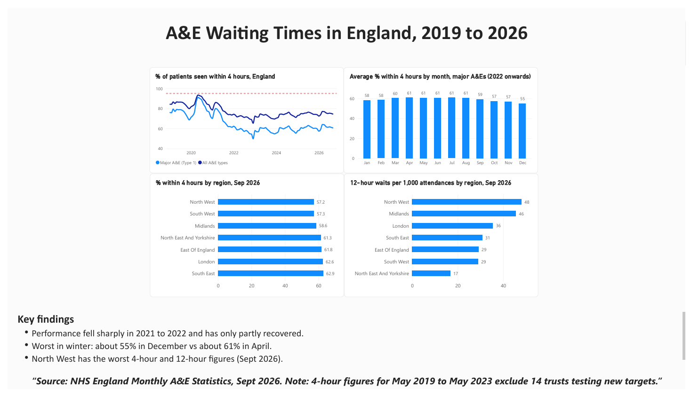

# A&E Waiting Times in England, 2019 to 2026

## Question
How have A&E waiting times in England changed since 2019, and which regions are doing worst?

## Key findings
- Performance fell sharply in 2021 to 2022 (major A&Es: 57.6% seen within 4 hours in 2022) and has only partly recovered (61.2% in 2026, vs 76.3% in 2019). The target is 95%.
- Performance is worst in winter: about 55% in December vs about 61% in April at major A&Es (2022 onwards).
- In September 2026, the North West had the lowest 4-hour performance (57.2%) and the highest rate of 12-hour waits (48.1 per 1,000 attendances).
- Differences between hospital trusts (36% to 45% in the worst 10) are larger than differences between regions.

## Dashboard

## Data
   ## Data
   - NHS England, [Monthly A&E Time Series (Sept 2026)](https://www.england.nhs.uk/statistics/statistical-work-areas/ae-waiting-times-and-activity/)
   - NHS England, [A&E Attendances and Emergency Admissions, Sept 2026 (monthly CSV)](https://www.england.nhs.uk/statistics/statistical-work-areas/ae-waiting-times-and-activity/ae-attendances-and-emergency-admissions-2026-27/)
   - Raw NHS files are not included. Download them from the links above. Cleaned files are in this repository.

## Method
Python (pandas, matplotlib) for cleaning and analysis; Power BI for the dashboard.
Cleaning included removing an empty column, trimming spaces, and removing a TOTAL row that would have double counted.

## Limitations
- 4-hour figures for May 2019 to May 2023 exclude 14 trusts testing new targets.
- Regional results are for September 2026 only.
- 12-hour waits are counted from decision to admit, and the rate per attendance is an approximation.
- 2026 has only 9 months of data.

## Next steps
Compare regions over several months; look at the link between 12-hour waits and winter pressure.
